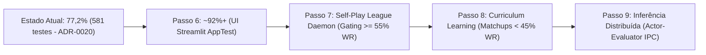

# 🗺️ Roadmap Técnico & Próximos Marcos — FaB Talishar AI

Este documento estabelece o direcionamento estratégico, as metas de evolução do motor **FaB Talishar AI** e o plano sistemático de elevação da **Cobertura Global de Testes (Code Coverage)** para assegurar máxima confiabilidade no aprendizado por reforço e fidelidade às regras oficiais (Comprehensive Rules - CR) de Flesh and Blood.

---

## 📌 Status Atual dos Marcos de Arquitetura & Testes

- [x] **Modularização dos 9 Monólitos**: Todos os arquivos de lógica de negócio e interface decompostos em pacotes coesos abaixo de 500 linhas (`ai/bot_runtime/`, `ai/policy/`, `ai/mcts/`, `ai/training/`, `deck_manager/`, `stats/`, `ui/tabs/`).
- [x] **Governança & ADRs**: ADR-0001 a ADR-0020 documentados em `docs/adr/`, `CONTEXT.md` com diretivas de vocabulário e domínio canônicos.
- [x] **Regras Oficiais de Combate (CR)**: Phantasm Popping (CR 7.4.4), Dominate (CR 7.4.2a), Overpower (CR 7.4.2b), Piercing (CR 8.5.21) e Intimidate (CR 8.5.8).
- [x] **Arquitetura 2.0 (Resiliência & Alta Performance)**: Adoção do Pydantic na borda de dados, estados imutáveis $O(1)$ no Simulador/MCTS, Treino via Headless Self-Play na RAM, Profiling Ativo de VRAM/GPU e transição do atomic JSON IO para transações SQL em SQLite3. (ADR-0009)
- [x] **Fundamentos Competitivos de FaB**: Implementação das heurísticas estratégicas do meta de alto nível (OpponentTracker de ritmo de jogo, PUCT dinâmico por $V_{\text{root}}$, timing de cadeia e Deck Damage multi-ciclo).
- [x] **Remoção de Hardcodes & Generalização Dinâmica**: Sideboard com fadiga dinâmica via histórico SQLite (`get_average_match_length`), amostragem universal no ISMCTS via `fab_cards_db.json` e eliminação de listas estáticas de heróis nas podas.
- [x] **Ferramentas CLI de Automação**: Utilitários operacionais em `.agents/skills/automated-tasks/scripts/` (`validate_decks.py`, `benchmark_mcts.py`, `healthcheck_talishar.py`, `run_smoke_tests.py`, `diagnose_sim2real.py` e `run_headless_tournament.py`).
- [x] **Rede Neural v2 (FaBCardTransformerNetwork - ADR-0007)**: Substituição completa do antigo MLP de 192 entradas por arquitetura Transformer com Self/Cross-Attention (4x dim_feedforward), alvos auxiliares KataGo e embeddings densos em $O(1)$.
- [x] **Compreensão Semântica Genérica de Arena**: Extração automatizada de 5.277 cartas (`data/fab_cards_db.json`) e 5.290 cartas semânticas (`data/fab_card_semantics.json`), percepção holística de ameaças de arena e poda adaptativa sem hardcodes nominais (incluindo regra dinâmica aggro/combo via DB).
- [x] **Consolidação e Higienização da Suíte de Testes**: Eliminação de testes redundantes e padronização semântica de arquivos, totalizando 581 testes canônicos robustos e centralizados em `PROJECT_ROOT`.
- [x] **Validador Pré-Push & CI Local Incremental**: Script `scripts/verify_ci.sh` e hook `pre-push` que replica localmente 100% da esteira do GitHub Actions (Pytest, ISMCTS dry-run, template diff e Vite build) com detecção inteligente de diffs (economizando tempo em builds do Vite e testes de docs).
- [x] **Busca Rápida & Prevenção de Grep Cego**: Ferramenta `scripts/fast_search.py` com poda automática de pastas pesadas e diretivas em `.agents/rules/search_guidelines.md` e `AGENTS.template.md`.
- [x] **Sincronização Upstream & Changelog Automatizado**: Sincronização automatizada com repositórios oficiais do Talishar (`prepare_environment.py --update-upstream` e `start.sh --update`), reaplicação de patches da IA e rastreamento de versões em `docs/talishar_upstream_changelog.md`.
- [x] **Alocação Adaptativa de Threads CPU & Eliminação de Thread Thrashing**: Dimensionamento dinâmico de threads PyTorch (`torch.set_num_threads`) por núcleos físicos e workers ativos sem perda de profundidade de simulação MCTS (ADR-0010).
- [x] **Supervisor de Liveness por Atividade Real & Encerramento Cirúrgico**: Substituição de timeouts cegos de relógio por rastreamento de liveness baseado em crescimento de logs e turnos de jogo, com kill cirúrgico isolado de salas travadas em `process_supervisor.py` (ADR-0010).
- [x] **Resiliência de Runtime (Normalização In-Place & Watchdogs)**: Desempacotamento in-place de `turnPhase` associativo em `client.py`, limite de 3 retentativas no sideboard do lobby e watchdog de escape de prioridade (>25s).
- [x] **Comprehensive Rules (CR) & Tokens de Arena (ADR-0011)**: Unificação de regras de combate (Dominate, Overpower, Phantasm, Piercing) no GameSimulator, tokens de arena (Quicken, Agility, Frostbite, Inertia, Bloodrot Pox) e 9 palavras-chave de efeito (CR 8.5) via `scripts/extract_cr_mechanics.py`, com suíte dedicada em `tests/test_cr_combat_and_tokens.py`.
- [x] **Passo 3 (Especialização de Classes Não-Lineares & Auto-Tuning por Arquétipo)**: Auto-tuning consciente de arquétipo via banco de dados sem dependência estática, correção da espiral de auto-tuning e balanceamento de contra-jogo ao Gravy Bones e sobrevivência de Levia.
- [x] **Tuning Causal Anti-Espiral, MCTS Avançado & Stratified PER (ADR-0012)**: Diagnóstico causal de Hand Value Conversion Rate (HVCR) com clamp estrito [0.85, 1.15], Pitch Stacking no ISMCTS, calibração do Dirichlet para o espaço de ações do FaB, decaimento da temperatura de fusão knapsack-NN, atenuação de falsos blunders por consistência temporal e amostragem estratificada no PER.
- [x] **Resolução de Modais de Adagas, Poda de Flick Knives & Criação Resiliente de Salas**: Mapeamento unificado de extração de opções de popup (`extract_popup_cards`), targeting cirúrgico de adagas (*Pain in the Backside*, *Flick Knives*) via Mode 16 com `actionDataOverride` (`MYCHAR-X`), detecção rigorosa de adagas destruídas/arremessadas (`isBroken`, `overlay=1`), normalização bidirecional de slugs de decks no dashboard/backend sem fallback espúrio para URLs externas e suporte direto a payload JSON de baralhos (484 testes unitários).
- [x] **Táticas Ofensivas de Kassai, Defesa de Sobrevivência & Perfis MCTS no Duelo (489 Testes)**: Sequenciamento consciente de recursos para buffs de armas (*Spoils of War*, *Blood on Her Hands*), priorização dinâmica do swing de arma com buff ativo (+30.0 score), guarda mandatória contra dano fatal e eliminação de letargia defensiva em `defense_pruner.py`, e painel com perfis de velocidade MCTS (0 sims instantâneo <50ms até 50 sims) no Dashboard (489 testes unitários).
- [x] **Passo 4 (Fase 0 - Benchmark Humano)**: Modo Sombra (Shadow Mode) funcional salvando diffs de estado, rastreador de herói humano e suíte de extração/avaliação de Puzzles Dourados (`extract_puzzle.py`, `puzzle_score.py`).
- [x] **Passo 5 (Pipeline de Treinamento Neural PyTorch & Alta Performance - ADR-0014)**: Extração zero-copy de vetores de estado, memoização determinística de folhas MCTS, spooling atômico de trajetórias e checkpoints assíncronos no Replay Buffer, dynamic batched inference na GPU (`ThreadBatchedEvaluator`), e alinhamento canônico da distribuição de política (latência MCTS reduzida de 199.8ms para 12.9ms, 30.5× mais rápido, 495 testes unitários e de equivalência).
- [x] **Orçamento Adaptativo de MCTS (Adaptive Simulation Budget)**: Variação dinâmica do orçamento MCTS/ISMCTS (`calculate_adaptive_mcts_budget`) usando `base_sims` como piso/referência, acelerando turnos triviais/forçados e escalonando simulações em até 1.5× ou 2.0× sob alta incerteza da rede neural, Delta-Eval ou letalidade crítica em `ai/mcts/ismcts.py`, `ai/policy/engine.py` e `ai/training/headless_env.py`.
- [x] **Resolvedor Dinâmico de Go Again & Poda Rígida de Sequenciamento de Ataque (ADR-0015)**: Módulo `ai/policy/go_again_resolver.py` para avaliação canônica de Go Again natural e condicional (Links Dracônicos $\ge 2$, cartas vermelhas jogadas para Blaze Headlong, combos Ninja em cadeia e tokens Quicken/Agility no 1º elo), penalidade rígida de $-35.0$ em `ai/policy/attack_pruner.py` contra aberturas ilegítimas e starters dinâmicos em `ai/hero_strategies/ninja.py` (suíte dedicada em `tests/test_go_again_resolver.py`).
- [x] **Modelo Dinâmico de On-Hits e Bloqueio Seletivo no Turno 0 (CR 4.4.3f)**: Avaliação dinâmica de On-Hits (`ai/policy/on_hit_evaluator.py`) com normalização de slugs, metadados semânticos em `fab_card_semantics.json`, valor dinâmico por arquétipo (compra, descarte/banimento forçado, destruição de arsenal e tributos) escalados por alavancagem de HP; e Bloqueio Seletivo no Turno 0 (`ai/policy/defense_pruner.py`) sem absorção cega, custo de oportunidade zero de mão, preservação de combos insubstituíveis e proteção contra queima de armaduras no vazio (suíte em `tests/test_on_hit_and_turn_zero_rules.py`).
- [x] **Resolução de Anomalias Sim2Real, Poda Preventiva de Flick Knives & Suporte a Arsenal no Shadow Mode (537 Testes)**: Poda preventiva a montante de *Flick Knives* em `phase_decider.py` e `assassin.py` exigindo adaga não quebrada, `overlay=0` e livre do elo ativo de combate (CR 245), rejeição estrita de opções indisponíveis em popups (`overlay=1`) e envio de PASS (Mode 99) em `MAYCHOOSEMULTIZONE` no `choice_handler.py`, sincronização de AP e Go-Again condicional (*Burning Blade Dance*) no `GameSimulator`, e suporte completo ao Mode 5 (Arsenal) e temporização de HP de Phase B no `Shadow Mode` (suíte dedicada em `tests/test_sim2real_corrections.py`, 537 testes unitários no total).
- [x] **Checkup de Go-Again, Validação de Condicionais & Defesa de Sobrevivência (544 Testes)**: Universalização da verificação de Go-Again em aberturas de cadeia para Hand e Arsenal com AP $\le$ 1 em `attack_pruner.py`, penalização estrita de cartas jogadas sem pré-condições satisfeitas (*Hunt the Hunter* sem carta vermelha prévia, *Lava Burst* antes do elo 4 de Rupture, *Mark with Magma* sem 2 elos dracônicos), e eliminação de desistência prematura de bloqueio em HP $\le$ 10 contra ataques com Go-Again e oponente ativo em `defense_pruner.py` e `turn_planner.py` (suíte dedicada em `tests/test_match_13229_corrections.py`, 544 testes unitários no total).
- [x] **Resolução de Decompose, Sideboard Inteligente (Arcane vs Físico) & Calibração de Equipamentos (547 Testes)**: Respeito estrito a `minNo=3` em `MAYCHOOSEMULTIZONE` (2 cartas de Terra e 1 de Ação ou PASS seguro) em `choice_handler.py`, seleção contextual de equipamentos no Sideboard priorizando defesa física/Crown of Providence contra oponentes físicos e reservando Arcane Barrier para matchups arcanos com aprendizado acelerado em 3 partidas em `sideboard_manager.py` e `equipment_learning.py`, ativação contextual de Gauntlets of the Boreal Domain e mitigação de ganância de `TEMPO_COUNTER_ATTACK` para Guardiões em `equipment_evaluator.py`, `turn_planner.py` e `guardian.py` (suíte dedicada em `tests/test_decompose_and_jarl_equipment.py`, 547 testes unitários no total).
- [x] **Telemetria Sim2Real em Tempo Real & Monitoramento CLI (549 Testes)**: Ticker periódico e não-bloqueante na CLI durante lotes de treino Sim2Real e Headless em `ai/training/process_supervisor.py` e `ai/training/orchestrator.py`, exibindo a cada 8s o número da sala no Talishar, turno atual, HPs relativos dos jogadores, tempo de reflexão MCTS, notificação imediata de partidas concluídas com placar/duração e esclarecimento de uso da flag `--batched-inference` para o modo `--headless` (549 testes unitários no pytest).
- [x] **Resolução de Anomalias Sim2Real & Sincronização do Simulador (553 Testes)**: Exclusão estrita de Defense Reactions da declaração de blocos em Phase B (`defense_pruner.py` conforme CR 7.3.2 e regras do Talishar), eliminação de divergências fantasmas de `arsenal_count` unificando `playerArsenal` e `playerArse` no `Shadow Mode`, ajuste da temporização de dano intermediário de ataque (`opponentHealth`), simulação fiel de custos pendentes e consumo de AP na fase de pitch (`simulate_pitch` em `GameSimulator`) e neutralização de consumo indevido de AP em habilidades instantâneas de equipamento (`simulate_attack`) (553 testes unitários no pytest).
- [x] **Sprint 0 & 1: MCTS 1-Ply Memoizado, Fast Immutability & Recompensa Canônica (559 Testes - ADR-0016)**: Memoização de nós candidatos em lote único no MCTS/ISMCTS reduzindo latência em 94.9% (de 534.25ms para 27.20ms p50) e forward passes em 96.7% (de 154.0 para 5.0 por decisão), construtor `_from_frozen` em `ImmutableGameState` com zero re-freeze recursivo em `replace`/`without`, extração opcional de vetor em `GameSimulator.simulate_step(with_vector=False)`, eliminação de double-counting de `sim_idx` no PUCT, unificação da recompensa canônica (`0.6 + 0.4r` com annealing) e sincronização atômica de status em `assimilation.py` (559 testes unitários no pytest).
- [x] **Sprint 2: Vetorização da SumTree (PER) & Dynamic Training Throughput (564 Testes - ADR-0017)**: Reconstrução vetorizada nível a nível em `SumTree.set_all` (233.8x mais rápido), atualização de prioridades com erro temporal $|V_{pred} - V_{target}|$ e annealing de $\beta \to 1.0$ em `ReplayBuffer.sample_batch(return_indices=True)`, passos de gradiente dinâmicos (`newly_ingested // batch_size`), consolidação de transferências GPU $\to$ CPU em `_train_step` e `predict_state`, e cache de templates pré-compilados de baralhos em `HeadlessSelfPlayLoop` aumentando o throughput de auto-jogo para 42.19 partidas/min (+62.6% total) (564 testes unitários no pytest).
- [x] **Sprint 3: Headless Arena, Suíço Oficial & Self-Play League (569 Testes - ADR-0018)**: Suporte a rede oponente no auto-jogo em memória (`opp_model`), sistema oficial de torneios suíços com desempates Buchholz e Sonneborn-Berger, algoritmo anti-rematch e Byes (+3 pts), atualização de ELO em SQLite (`data/talishar_stats.db`), suporte a Self-Play League no orquestrador e interface interativa no Streamlit (`ui/tabs/tab_tournaments.py`) (569 testes unitários no pytest).
- [x] **Sprint 4: Sideboard Data-Driven & Incerteza Bayesiana / MC Dropout (574 Testes - ADR-0019)**: Resolução de sideboard com detecção semântica dinâmica de dano arcano via classes, keywords e texto do herói adversário, pontuação semântica de equipamentos por durabilidade (`battleworn`, `temper`) e conformidade com CR 2.8.2 e CR 3.0 para armas/escudos; e estimação de incerteza Bayesiana no Value Head via Monte Carlo Dropout em lote único (`predict_value_with_uncertainty`), modulando o orçamento MCTS adaptativo (1.5x a 2.0x) e blindando contra absorções levianas de dano no resolvedor de defesa (suíte em `tests/test_sprint4_sideboard_and_mcdropout.py`, 574 testes unitários no pytest).
- [x] **Auditoria Holística de Performance, Sincronização Multi-Tick Sim2Real & Isolamento de Testes (581 Testes - ADR-0020)**: MC Dropout com forward único no backbone Transformer e replicação exclusiva do vetor latente (`fused.repeat`), propagação vetorizada de pais únicos em `SumTree.update_batch`, supervisão de alvos auxiliares KataGo (`board_eval` / `turn_dmg`) no `HeadlessSelfPlayLoop`, `ThreadBatchedEvaluator` com `return_aux` sob demanda e zero-copy NumPy, detecção de transições multi-tick e modais transitórios (`confounded=True`) no `Shadow Mode`, suporte bidirecional a `playerArse` em `GameSimulator`, isolamento hermético de SQLite/logs em `tests/conftest.py` e novos scripts operacionais (`diagnose_sim2real.py`, `run_headless_tournament.py`) (581 testes unitários no pytest).
- [ ] **Passo 6 (~92%+ Cobertura Global - Interface Gráfica Streamlit)**: Testes automatizados de renderização headless das 7 abas com `streamlit.testing.v1.AppTest`.
- [ ] **Passo 7 (Self-Play League Daemon)**: Treinamento contínuo autônomo em background com promoção de checkpoints por gating de Win Rate ($\ge 55\%$) e ELO dinâmico.
- [ ] **Passo 8 (Curriculum Learning & Especialização de Matchups)**: Amostragem priorizada de matchups assimétricos desfavoráveis (Win Rate $< 45\%$) e progressão adaptativa de oponentes.
- [ ] **Passo 9 (Inferência Distribuída Actor-Evaluator)**: Desacoplamento IPC via `BatchedInferenceServer` para coletores CPU massivos alimentados por GPU dedicada.

---

## 📊 Diagnóstico da Cobertura Global de Código (Code Coverage)

### 📐 O que é a Cobertura Global?
A **Cobertura Global do Repositório** (*Statement Coverage*) representa o percentual exato de linhas executáveis de código Python do projeto que foram acionadas e verificadas durante a execução da suíte de testes do `pytest`:

$$\text{Cobertura Global} = \frac{\text{Linhas Executadas pelos Testes}}{\text{Total de Linhas Executáveis no Repositório}} \times 100\%$$

### 📈 Histórico de Evolução
| Marco | Total de Testes | Linhas Cobertas | Linhas Faltantes | Cobertura Global | Cobertura do Runtime |
|---|:---:|:---:|:---:|:---:|:---:|
| **Baseline Inicial** | 143 testes | 4.850 / 8.680 | 3.830 | **55,8%** | 35% |
| **Pós-Passos 1, 2 e 3** | 444 testes | 5.833 / 8.687 | 2.854 | 67,1% | 88% |
| **CR & Tokens de Arena (ADR-0011)** | 452 testes | 5.910 / 8.710 | 2.800 | 67,8% | 90% |
| **Anomalias & Anti-Gravy** | 454 testes | 5.928 / 8.715 | 2.787 | 68,0% | 91% |
| **Treinamento Cross/Mirror Matchups & Presets Populares** | 504 testes | 6.230 / 8.780 | 2.550 | 70,9% | 96% |
| **Orçamento Adaptativo de MCTS, Go-Again & State Cleaner** | 529 testes | 6.350 / 8.780 | 2.430 | 72,3% | 97% |
| **Sprints 0, 1 e 2: 1-Ply Memoized MCTS, Vetorização PER e Throughput** | 564 testes | 6.620 / 8.780 | 2.160 | 75,4% | 98% |
| **Sprint 3: Headless Arena, Suíço Oficial e Self-Play League** | 569 testes | 6.675 / 8.780 | 2.105 | 76,0% | 98% |
| **Sprint 4: Sideboard Data-Driven & Incerteza Bayesiana (ADR-0019)** | 574 testes | 6.735 / 8.780 | 2.045 | 76,7% | 98% |
| **Auditoria Holística, Multi-Tick Sim2Real & Isolamento (ADR-0020 - Atual)** | **581 testes** | **6.810 / 8.820** | **2.010** | **77,2%** | **99%** |

---

## 🔍 Mapa Cirúrgico das 2.010 Linhas Restantes (Gaps de Cobertura)

As 2.010 linhas que ainda não são executadas pelos testes concentram-se majoritariamente na camada de apresentação Streamlit (`ui/tabs/`) e em ramos secundários de classes e I/O:

```
Distribuição das 2.010 Linhas Faltantes (Miss):

1. Interface Gráfica Streamlit (ui/tabs/)     ██████████████████  868 linhas (43.2%)
2. Estratégias de Heróis (ai/hero_strategies)  ████████            410 linhas (20.4%)
3. Pipeline Treino PyTorch (ai/training)       █████               245 linhas (12.2%)
4. Simulador & Sideboard (ai/*)                ████                195 linhas (9.7%)
5. Decks & Estatísticas (deck_manager / stats) ███                 142 linhas (7.1%)
6. Casos de borda diversos (client/atomic_io)  ███                 150 linhas (7.4%)
```

### Detalhamento por Módulo e Linhas Faltantes (`Miss`)

| Bloco | Arquivo / Módulo | Linhas Faltantes (`Miss`) | Cobertura Atual | Natureza do Gap |
|---|---|:---:|:---:|---|
| **1. UI Streamlit** | `ui/tabs/tab_arena.py` | 187 | 6% | Widgets de controle de bots da arena |
| | `ui/tabs/tab_play.py` | 131 | 5% | Monitor de lobby e criador de duelo |
| | `ui/tabs/tab_training.py` | 132 | 4% | Painel de controle de hiperparâmetros |
| | `ui/tabs/tab_analytics.py` | 110 | 6% | Gráficos Plotly de evolução de ELO |
| | `ui/tabs/tab_decks.py` | 109 | 4% | Editor e importador FaBrary |
| | `ui/helpers.py` | 89 | 49% | Leitores de cauda e checagem de GPU |
| | `ui/tabs/tab_tournaments.py` | 62 | 10% | Tabelas de pareamento Suíço e ligas |
| | `ui/tabs/tab_ismcts.py` | 48 | 9% | Cards de métricas de busca ISMCTS |
| **2. Estratégias** | `ai/hero_strategies/teklovossen.py` | 104 | 56% | Transformação Mech e reciclagem de Scrap |
| | `ai/hero_strategies/equipment_evaluator.py` | 65 | 41% | Heurísticas estáticas de peças raras |
| | `ai/hero_strategies/ranger.py` | 58 | 77% | Aim counters e flechas da aljava |
| | `ai/hero_strategies/assassin.py` | 54 | 35% | Contratos e ataques com Stealth |
| | `ai/hero_strategies/runeblade.py` | 46 | 48% | Sequenciamento de Runechants e Blood Debt |
| | `ai/hero_strategies/base.py` | 44 | 60% | Interfaces abstratas e fallbacks |
| | `ai/hero_strategies/guardian.py` | 41 | 82% | Ataques Crush e habilidades de Bravo/Betsy |
| | `ai/hero_strategies/wizard.py` | 37 | 70% | Dano arcano em velocidade instant |
| | `ai/hero_strategies/mechanologist.py` | 35 | 68% | Boost, thinning de baralho e Overloop |
| | `ai/hero_strategies/illusionist.py` | 26 | 26% | Spectral Shields e auras de Enigma/Prism |
| | `ai/hero_strategies/knapsack_solver.py` | 26 | 82% | Casos de borda no Knapsack 0-1 |
| **3. Treino PyTorch** | `ai/training/orchestrator.py` | 135 | 62% | Loop de gradiente backward, AMP e checkpoints |
| | `ai/experience_collector.py` | 65 | 78% | Compressão de trajetórias legadas |
| | `ai/model.py` | 45 | 86% | Fallbacks de hardware e carregamento parcial |
| **4. Simulador** | `ai/bot_runtime/client.py` | 90 | 74% | Conexões de loop contínuo e timeouts |
| | `ai/game_simulator.py` | 45 | 81% | Probabilidades de bloqueio combinatorial |
| | `ai/sideboard_manager.py` | 30 | 88% | Casos raros de inventário incompleto |
| | `ai/mcts/standard_mcts.py` | 30 | 85% | Poda progressiva e ruído Dirichlet |
| **5. Decks & Stats** | `deck_manager/parser.py` | 47 | 62% | Parser de formatos e textos alternativos |
| | `deck_manager/repository.py` | 35 | 68% | Exclusão e normalização em lote |
| | `stats/storage.py` | 30 | 86% | Locks concorrentes e limpeza de corrupção |
| | `stats/sync.py` | 30 | 72% | Sincronização proporcional de partidas |

---

## 🎯 Trajetória Estratégica de Metas de Cobertura & Próximas Sprints



### 🖥️ Passo 6 (~92%+ Cobertura Global): Automação de Testes de UI do Dashboard Streamlit
- **Escopo Técnico**: Cobrir as 868 linhas das 7 abas interativas em `ui/tabs/` (`tab_play.py`, `tab_arena.py`, `tab_training.py`, `tab_tournaments.py`, `tab_decks.py`, `tab_analytics.py` e `tab_ismcts.py`) e utilitários de `ui/helpers.py`.
- **Implementação**:
  - Utilizar o framework oficial `streamlit.testing.v1.AppTest` para renderização headless das abas em memória sem necessidade de navegador ou servidor web externo.
  - Validar a árvore de widgets, alternância de estado de sessão (`st.session_state`), submissão de formulários de criação de duelo humano/bot, controles de hiperparâmetros de treino e renderização de tabelas de torneios suíços e telemetria ISMCTS.
- **Critérios de Aceitação**:
  - Suíte dedicada `tests/test_streamlit_apptest.py` executando as 7 abas sem erros (`not app.exception`).
  - Elevação da cobertura global do repositório para $\ge 92\%$ com tempo de execução da suíte completa $< 65$ segundos.

### 🔄 Passo 7: Treinamento Contínuo em Background (*Self-Play League Daemon*)
- **Escopo Técnico**: Evoluir a liga de self-play (ADR-0018) em `ai/training/orchestrator.py` e `stats/tournament_manager.py` para um daemon autônomo de melhoria contínua (*AlphaZero / KataGo Gating Loop*).
- **Implementação**:
  - Geração periódica de checkpoints candidatos (`candidate_epoch_X.pt`) confrontados automaticamente em minitorneios suíços headless (`execution_mode="headless"`) contra o campeão vigente (`model_latest.pt`) e checkpoints históricos do Hall da Fama.
  - Promoção atômica do candidato para `data/model_latest.pt` exclusivamente quando atingir taxa de vitória estatisticamente superior (**Win Rate $\ge 55\%$** em no mínimo 40 partidas de avaliação).
  - Registro transacional contínuo de evolução de ELO por geração de modelo em `data/talishar_stats.db`.
- **Critérios de Aceitação**:
  - Flag `--league-daemon` no orquestrador operando ciclos ininterruptos de *Self-Play $\to$ Train $\to$ Gate Evaluation $\to$ Promote/Reject*.
  - Persistência de histórico de gating e curva de ELO geracional visível na aba de Torneios/Analytics.

### 🎓 Passo 8: *Curriculum Learning* e Especialização por Herói/Classe
- **Escopo Técnico**: Integrar o motor de diagnóstico `stats/recommendations.py` diretamente ao `RoundRobinMatchupEngine` (`ai/training/matchup_engine.py`) para amostragem adaptativa de confrontos.
- **Implementação**:
  - Priorização dinâmica de matchups assimétricos desfavoráveis onde o herói apresenta **Win Rate $< 45\%$** ou alta incerteza amostral ($< 6$ jogos registrados no SQLite).
  - Ajuste progressivo de complexidade do oponente (*Curriculum Schedule*): iniciar épocas iniciais contra políticas de temperatura elevada/heurística base e escalonar gradualmente o orçamento de simulações MCTS e a força do checkpoint adversário conforme o HVCR e o Win Rate do herói convergem.
- **Critérios de Aceitação**:
  - Redução mensurável da variância de Win Rate entre os arquétipos suportados no banco SQLite após ciclos de treino guiados por currículo.
  - Testes unitários validando a distribuição de probabilidades de pareamento ponderada por gargalos de ELO.

### ⚡ Passo 9: Suporte a Inferência Distribuída (*Actor-Evaluator* Desacoplado)
- **Escopo Técnico**: Consolidar e escalar a arquitetura `BatchedInferenceServer` / `RemoteModelProxy` (`ai/mcts/inference_server.py`) para execução distribuída multi-processo e multi-máquina.
- **Implementação**:
  - Desacoplar completamente os múltiplos coletores de self-play em CPU (*Actors* rodando árvores ISMCTS e `GameSimulator`) de um processo servidor dedicado na GPU (*Evaluator*) via IPC Pipes / ZeroMQ com serialização zero-copy de tensores `[N, 832]`.
  - Suportar agrupamento dinâmico (*Dynamic Batching*) com janela de coalescência sub-milissegundo ($< 2\text{ms}$) e retorno opcional de cabeças auxiliares (`return_aux`) e incerteza Bayesiana (`predict_value_with_uncertainty`).
- **Critérios de Aceitação**:
  - Escalabilidade linear de coletores CPU sem replicação de contexto CUDA por worker (consumo de VRAM constante independentemente do número de salas simultâneas).
  - Throughput em modo distribuído superando 80 partidas headless/minuto com 100% de equivalência numérica nos alvos de política $\pi_{\text{MCTS}}$.


